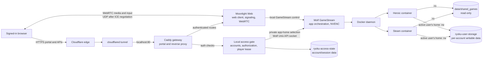

# Ryoku Cloud Gaming Architecture

This document describes the architecture implemented by this repository. It
covers the public browser route, local account checks, game-session lifecycle,
stream transport, storage, and host startup. The deployment is a single Linux
gaming host with one active browser player slot.

## 1. System overview

Ryoku combines a small web portal and local account service with Moonlight Web,
Wolf (Games on Whales), and on-demand game containers. Cloudflare Tunnel
provides public HTTPS ingress without requiring an inbound web port on the
router. After stream setup, Moonlight Web attempts to carry the actual game
media and input directly over WebRTC/UDP; that traffic is separate from the
Cloudflare HTTP tunnel.



Cloudflare Tunnel carries the portal, authenticated HTTP requests, and stream
signaling. WebRTC media and controller input use a peer connection selected by
ICE; when UDP cannot connect, the client may use a TCP/WebSocket fallback with
higher latency. See the [Moonlight Web transport documentation](https://github.com/linckosz/moonlight-web/blob/main/docker/README.md).

## 2. Main services

| Component | Container or unit | Responsibility |
| --- | --- | --- |
| Caddy | `ryoku-gateway` | Serves `web/` and routes player requests. Its sites bind to loopback; Cloudflare Tunnel connects to the local HTTP listener. |
| Access gate | `ryoku-access-gate` | Registers and authenticates local accounts, checks authorization, grants the single player lease, and selects the active account's Wolf app home. |
| Moonlight Web | `ryoku-moonlight-web` | Serves the browser streaming client and negotiates WebRTC streams with the browser and Wolf. Runs with host networking. |
| Wolf | `ryoku-cloud-server` | Exposes the GameStream host API, creates isolated app containers on demand, manages virtual display/input, and uses the NVIDIA encoder. Runs with host networking. |
| `cloudflared` | `ryoku-cloudflare-tunnel.service` | Maintains the outbound tunnel and maps the public gaming hostnames to local Caddy on port 80. |
| Docker | `docker.service` | Runs the platform containers and the game containers created by Wolf. |

The Compose project also has one-shot initialization containers:

- `wolf-config` seeds Wolf's persistent configuration and client identity into
  `ryoku-user-storage` before Wolf starts.
- `moonlight-config` seeds the Moonlight Web hostname/setup values into
  `ryoku-mw-data` without replacing generated identity material.

The game launchers are not long-running Compose services. Wolf creates Steam or
Heroic containers when a player selects an app. Game containers run with a
virtual Wayland compositor; the host desktop is not the streamed display. Wolf
gets the NVIDIA device/runtime access needed for encoding and the input device
nodes needed for virtual gamepads. The app containers use their own virtual
display session and the GPU devices passed through the host.

## 3. Public request and account flow

1. A browser opens `https://play.vanshdev.online`. Cloudflare terminates public
   TLS and sends the request through the tunnel to Caddy at `127.0.0.1:80`.
2. Caddy serves the static portal from the read-only `./web` bind mount. The
   portal posts registration and sign-in requests to the access gate.
3. The access gate stores local account records in `ryoku-access-state`. It
   stores a random salt and PBKDF2-HMAC-SHA256 password hash rather than the
   password. Public registration creates a player role; admin accounts are
   provisioned locally. No external identity provider is required.
4. Successful sign-in sets an HTTP-only session cookie. The account session
   lasts up to seven days. Sign-in and registration requests are rate-limited.
5. The portal shell and health endpoint are public. Account APIs require a
   signed-in account; stream routes additionally require the browser to hold
   the active player lease.

The portal calls `POST /api/session/acquire` before opening the stream. The gate
permits one account/browser session to own the shared Wolf/Moonlight Web slot
at a time. It renews the lease through heartbeats (the lease expires after two
minutes without one) and clears it when the player closes the stream or signs
out. This prevents two website players from switching one another's active
Wolf profile during a session.

For the active account, the gate derives a private profile directory named
`account-<account-id-hash>` beneath the Wolf app-state volume. It creates the
app directories and updates the configured Wolf client through Wolf's Unix
socket. Moonlight authentication is also mediated by the gate: it checks the
account and active lease, then asks the local Moonlight Web API to validate its
certificate token. That token is read from the Moonlight data volume mounted
read-only into the gate.

## 4. Caddy routing and service boundaries

Caddy is the only HTTP origin exposed to `cloudflared`. In the current
configuration it binds its HTTP/HTTPS site addresses to `127.0.0.1`. The
Moonlight Web server also uses host networking, but the access-gate firewall
blocks direct non-loopback access to its HTTP control ports (`8080` and `8443`).

The main Caddy route groups are:

| Route | Gate behavior | Backend |
| --- | --- | --- |
| `/` and portal assets | Public portal shell | Files in `/usr/share/caddy` from `./web` |
| `/api/auth/register`, `/api/auth/login` | Public, same-origin sign-in flows | Access gate on `127.0.0.1:9080` |
| `/api/account/*`, `/api/session/*` | Requires a valid account session | Access gate |
| `/api/auth/validate` | Requires account session and active lease | Access gate, which validates with Moonlight Web |
| `/stream*`, Moonlight `/api/*`, `/ws*`, and static stream assets | Requires active player lease | Moonlight Web on `localhost:8080` |
| `/admin*`, `/api/admin*`, `/api/local*` | Denied through the player website | No public backend route |

The Moonlight reverse-proxy blocks set the upstream `Host` and `Origin` to
`localhost:8080` and remove conflicting frame/security headers. Moonlight Web
checks that the origin matches its local authority; changing these headers can
break WebSocket stream setup with HTTP 403 errors.

`/api/health` is a lightweight edge response from Caddy. It verifies that the
gateway can answer but is not, by itself, an end-to-end game-launch or media
transport test. The access gate has its own `/healthz` endpoint for the Compose
health check.

## 5. Streaming and network paths

Moonlight Web and Wolf use host networking so their streaming protocols and
UDP sockets can operate without Docker bridge translation. The portal and
signaling are proxied through Caddy. Once ICE selects a usable candidate pair,
video, audio, and browser input use the WebRTC connection between the client
and Moonlight Web. For example, a LAN browser can exchange media directly with
the host's LAN address. Cloudflare Tunnel does not relay that UDP media path.

| Traffic | Typical path | Notes |
| --- | --- | --- |
| Portal, login, account/session APIs | Browser → Cloudflare → Tunnel → Caddy → Access gate | Web requests use the authenticated site origin. |
| Moonlight page and signaling | Browser → Cloudflare → Tunnel → Caddy → Moonlight Web | Includes WebSocket signaling. |
| Stream media and input | Browser ↔ Moonlight Web over WebRTC/UDP | ICE may choose a LAN, IPv6, or public/NAT-traversed pair. UPnP is enabled in Compose. |
| Wolf app and GameStream control | Moonlight Web ↔ Wolf on the host | Wolf's native GameStream ports are not intended as public website routes. |
| Game pixels and audio | Isolated game container → Wolf encoder → Moonlight Web → browser | NVIDIA hardware encoding is used when available. |

Moonlight Web uses UDP ports `48550–48573` for WebRTC media slots. If the
router's UPnP mapping does not work for off-site clients, the setup guide
recommends forwarding that UDP range to the gaming host. If UDP fails, a
TCP/WebSocket fallback may work but can add delay. The access gate also installs
host firewall rules to drop non-loopback access to Moonlight Web control ports
and Wolf's GameStream ports: TCP `47984`, `47989`, `47990`, `48010`, and UDP
`47998`, `47999`, `48000`, `48010`. This means direct native Moonlight access to
Wolf is blocked by the current public player boundary; browser streaming is the
configured public path. Do not expose the host desktop or Wolf's administrative
APIs as a shortcut around the portal.

## 6. Game launch and per-player storage

The effective Wolf app catalog and encoder configuration is
`wolf/config/cfg/config.toml`. The `wolf-config` initialization container copies
it into the `cfg/` directory in Wolf's persistent app-state volume before Wolf
starts. It includes:

- **Steam Cloud Gaming**, image `ghcr.io/games-on-whales/steam:edge`.
- **Heroic Games Launcher (Epic & GOG)**, image
  `ghcr.io/games-on-whales/heroic-games-launcher:edge`.

Each launcher is spawned only when selected. Wolf supplies its per-client
writable app home for launcher configuration, installs, saves, credentials,
and Proton/Wine prefixes. The optional master library at `data/shared_games`
is mounted into launcher containers at `/shared_games:ro`; a game container
must not be able to modify that shared source. The writable named volume
`ryoku-user-storage` is external to Compose so user profiles persist across
container recreation. The setup script creates it if absent.

The access gate's `ryoku-access-state` volume holds account records, login
sessions, and the active lease. The `ryoku-mw-data` volume holds Moonlight Web
settings and generated identity material. `ryoku-wolf-runtime` holds Wolf's
runtime socket and related state. `ryoku-caddy-data` and `ryoku-caddy-config`
persist Caddy-managed data and configuration. Back up account data and player
profiles together; they are separate volumes with related identity mappings.

`wolf/config/cfg/config.toml` sets `XDG_RUNTIME_DIR=/tmp` for launcher containers.
This avoids a known Steam image startup failure when its default
`/tmp/.X11-unix` runtime directory is absent. The game images use their own
isolated Wayland session, GPU/device access, and the shared read-only mount.

## 7. Host startup and service recovery

The host uses two systemd scopes:

1. `docker.service` is a system service and must be enabled at boot.
2. `ryoku-cloud-gaming.service` is a user `systemd --user` oneshot service. The
   installer enables lingering for the user so the user service manager can
   start without a desktop login. Its `ExecStart` runs `autostart.sh start`.
3. `autostart.sh` waits for Docker (up to 90 seconds), checks the NVIDIA driver
   and input-device nodes, then runs `docker compose up -d` and waits for the
   local gateway health endpoint.
4. `ryoku-cloudflare-tunnel.service` is a system service. It waits for network
   online and reconnects on failure. It forwards `play.vanshdev.online` and
   `vanshdev.online` to local Caddy.

Core Compose services use `restart: unless-stopped`, so Docker can recover
them after daemon restart. Initialization containers use a `no` restart policy
because Compose runs them as dependencies when needed. Game containers are
on-demand and are not expected to auto-launch at machine boot; players sign in
and choose a launcher after the platform is online.

Useful operational commands:

```bash
./autostart.sh status
docker compose ps
curl -s http://127.0.0.1/api/health
systemctl --user status ryoku-cloud-gaming.service
systemctl status ryoku-cloudflare-tunnel.service
```

Logs are available through `docker logs ryoku-gateway`,
`docker logs ryoku-access-gate`, `docker logs ryoku-moonlight-web`, and
`docker logs ryoku-cloud-server`. Avoid restarting the stack while a player is
using it unless a restart is needed to recover a failed service.

## 8. Deployment and operational constraints

- Do not expose the host desktop, personal files, terminal, or host login
  session through the streaming path. Games run inside Wolf-managed containers.
- Keep `data/shared_games` mounted read-only in all game containers.
- Keep writable launcher state and player data in per-account subdirectories
  under `ryoku-user-storage`.
- Never put Cloudflare credentials, account passwords, certificates, or
  private keys in source control or this document. Keep credentials in their
  designated volumes or user configuration directories.
- Wolf has the Docker socket mounted because it needs to create game
  containers. Access to Wolf and that socket is a privileged control plane and
  must remain restricted to trusted services.
- The provisioning script pins the amd64 Steam and Heroic image digests before
  tagging them as `edge`, to avoid known GHCR multi-architecture pull stalls.
  A launcher cannot start if its image is absent locally and the pull fails.

## 9. Repository map

| Path | Role |
| --- | --- |
| `docker-compose.yml` | Containers, network mode, volumes, dependencies, health checks, and restart policies. |
| `Caddyfile` | Portal serving, account/session routing, stream authorization, and Moonlight proxy headers. |
| `web/` | Static portal UI and browser-side session/stream behavior. |
| `deploy/access-gate/` | Local account service, authorization, session leases, and ingress firewall rules. |
| `deploy/cloudflared-config.yml` | Public hostname-to-local-origin tunnel ingress. |
| `deploy/enable_autostart.sh` | Installs/enables the headless user systemd startup unit and user lingering. |
| `autostart.sh` | Stack start/stop/status controller. |
| `deploy/wolf-config/` | Seeds Wolf config and paired client state. |
| `deploy/moonlight-config/` | Seeds Moonlight Web configuration while preserving generated secrets. |
| `wolf/config/cfg/config.toml` | Effective Wolf GameStream encoder and launcher definitions, seeded into the persistent app-state volume. |
| `data/shared_games/` | Optional master game library, mounted read-only in launcher containers. |
