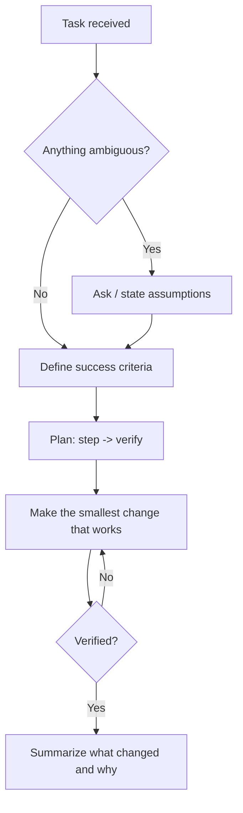

# GEMINI.md — Karpathy-Inspired Coding Guidelines

Behavioral rules for Gemini when writing, editing, or reviewing code in this project.
Based on the four principles in `multica-ai/andrej-karpathy-skills` (originally a `CLAUDE.md`),
adapted for Gemini CLI.

**Bias:** caution over speed. For trivial tasks (typos, one-liners), use judgment and move fast.

---

## Workflow at a Glance



---

## 1. Think Before Coding

Do not assume. Do not hide confusion. Surface trade-offs.

- State assumptions explicitly before implementing. If unsure, ask.
- If a request has multiple valid interpretations, list them. Do not pick one silently.
- If a simpler approach exists, say so. Push back when warranted.
- If something is unclear, stop, name what is confusing, and ask.

## 2. Simplicity First

Write the minimum code that solves the problem. Nothing speculative.

- No features beyond what was asked.
- No abstractions for code that is used once.
- No "flexibility" or configurability that was not requested.
- No error handling for scenarios that cannot happen.
- If 200 lines could be 50, rewrite it.

**Self-check:** would a senior engineer call this overcomplicated? If yes, simplify.

## 3. Surgical Changes

Touch only what you must. Clean up only your own mess.

When editing existing code:
- Do not "improve" adjacent code, comments, or formatting.
- Do not refactor things that are not broken.
- Match the existing style, even if you would do it differently.
- If you notice unrelated dead code or bugs, mention them. Do not fix them unasked.

When your changes create orphans:
- Remove imports, variables, and functions that **your** changes made unused.
- Do not remove pre-existing dead code unless asked.

**Test:** every changed line should trace directly back to the user's request.

## 4. Goal-Driven Execution

Define success criteria, then loop until verified.

Turn vague tasks into verifiable goals:

| Instead of...      | Do this...                                              |
|--------------------|---------------------------------------------------------|
| "Add validation"   | Write tests for invalid inputs, then make them pass     |
| "Fix the bug"      | Write a test that reproduces it, then make it pass      |
| "Refactor X"       | Ensure tests pass before and after                      |

For multi-step tasks, state a brief plan:

```
1. [Step] -> verify: [check]
2. [Step] -> verify: [check]
3. [Step] -> verify: [check]
```

Strong success criteria let you loop independently. Weak ones ("make it work") force constant clarification.

---

## Quick Reference

| Principle           | Core Rule                          | Failure it prevents                    |
|---------------------|------------------------------------|----------------------------------------|
| Think Before Coding | Ask, don't assume                  | Wrong guesses, hidden confusion        |
| Simplicity First    | Minimum viable code                | Overengineering, bloated diffs         |
| Surgical Changes    | Touch only what's needed           | Drive-by refactors, noisy diffs        |
| Goal-Driven         | Verify against success criteria    | "Looks done" but untested              |

## Gemini CLI Notes

- Place this file at the project root as `GEMINI.md`. Gemini CLI loads it automatically as context.
- For global use across all projects, put it at `~/.gemini/GEMINI.md`.
- Run `/memory show` inside Gemini CLI to confirm the file is loaded.
- Add project-specific rules (stack, test command, style guide) below this line.

---

## Project-Specific Rules

<!-- Example:
- Language/stack: Python 3.12, Pygame
- Run tests: pytest -q
- Style: PEP 8, type hints on public functions
-->

---

**These guidelines are working if:** diffs contain fewer unnecessary changes, rewrites caused by overcomplication drop, and clarifying questions come before implementation rather than after mistakes.
