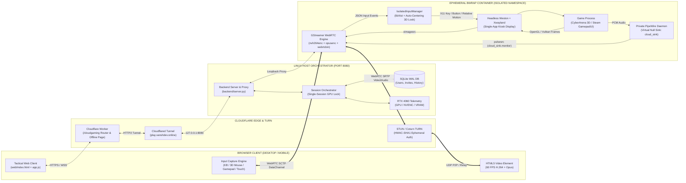
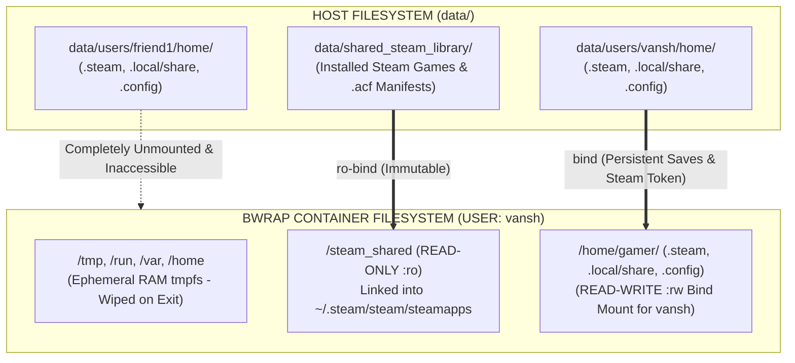
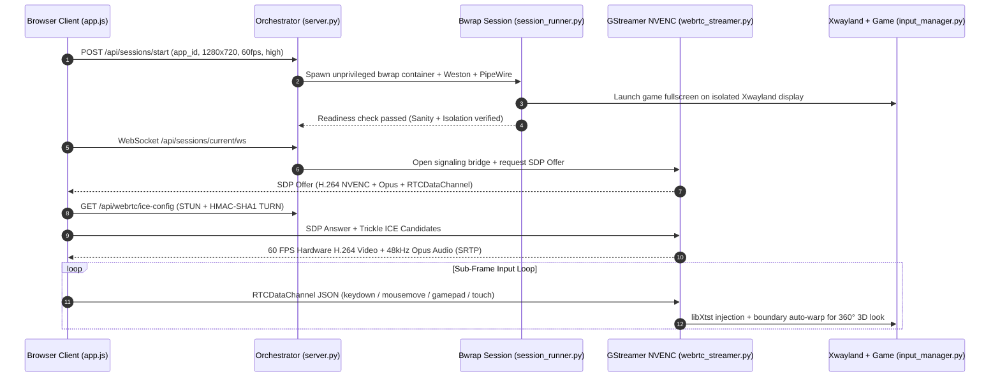

# RYOKU // CLOUD GAMING ENGINE

```text
+-----------------------------------------------------------------------------------+
|  RYOKU CLOUD GAMING PLATFORM  //  SELF-HOSTED WEBRTC GAME STREAMING ENGINE        |
|  ARCHITECTURE : BUBBLEWRAP SANDBOX + WESTON/XWAYLAND + PIPEWIRE + GSTREAMER NVENC |
|  TARGET GPU   : NVIDIA GEFORCE RTX 4060 (NVENC H.264 + OPUS AUDIO + DATACHANNEL)  |
|  SECURITY     : STRICT ZERO-HOST-ACCESS CONTAINER ISOLATION PER SESSION           |
+-----------------------------------------------------------------------------------+
```

[](file:///home/vansh/Projects/Home_Cloud_Gaming/PLAN.md)
[](file:///home/vansh/Projects/Home_Cloud_Gaming/engine/webrtc_streamer.py)
[](file:///home/vansh/Projects/Home_Cloud_Gaming/engine/sandbox.py)
[](file:///home/vansh/Projects/Home_Cloud_Gaming/backend/network_manager.py)

**Ryoku Cloud Gaming** is a self-hosted, browser-based cloud gaming platform that turns a Linux gaming PC into an isolated, low-latency cloud gaming server. Players connect from any desktop, laptop, tablet, or mobile browser (`https://vanshdev.online/cloudgaming` or `https://play.vanshdev.online`) and stream hardware-accelerated 60 FPS video and stereo Opus audio over WebRTC with sub-frame `RTCDataChannel` input injection.

---

## TABLE OF CONTENTS

1. [Core Security Architecture](#1-core-security-architecture)
2. [System Architecture & Visual Dataflow](#2-system-architecture--visual-dataflow)
3. [Filesystem & Per-User Persistence Model](#3-filesystem--per-user-persistence-model)
4. [WebRTC Media & Input Pipeline Sequence](#4-webrtc-media--input-pipeline-sequence)
5. [Control System & Input Mapping Matrix](#5-control-system--input-mapping-matrix)
6. [Repository Structure](#6-repository-structure)
7. [Quickstart & Production Deployment](#7-quickstart--production-deployment)
8. [Verification & Automated Test Suite](#8-verification--automated-test-suite)

---

## 1. CORE SECURITY ARCHITECTURE

> [!IMPORTANT]
> **Strict Per-Session Isolation Rule**
> When a user launches a game, they interact exclusively with that isolated game instance. Players can never view or access the host desktop, host `/home` directory, host processes, physical `/dev/input` devices, host `/dev/snd` speakers/microphones, or another user's files. Every session boots inside a fresh unprivileged Bubblewrap (`bwrap`) container and is wiped on termination.

| Security Layer | Enforcement Mechanism | Host Exposure |
| :--- | :--- | :--- |
| **Process & IPC Namespace** | `bwrap --unshare-pid --unshare-ipc --unshare-uts --die-with-parent` | Blocked (Isolated PID 1 tree) |
| **Host Home Directory** | Ephemeral `tmpfs` mounted over `/home`, `/root`, `/tmp`, `/run`, `/var` | Blocked (`0` host files visible) |
| **Display Server** | Dedicated headless `weston` (`wayland-cloud-0`) + isolated `Xwayland` (`:99`) | Blocked (Host X11/Wayland hidden) |
| **Audio Subsystem** | Private `pipewire` + `wireplumber` graph with virtual `cloud_sink` | Blocked (Host `/dev/snd` hidden) |
| **Input Subsystem** | `libXtst` synthetic events injected strictly into isolated display `:99` | Blocked (Host `/dev/input` hidden) |
| **GPU Device Access** | Selective bind-mount of `/dev/dri` and `/dev/nvidia*` only | Scoped to 3D rendering & NVENC |

---

## 2. SYSTEM ARCHITECTURE & VISUAL DATAFLOW



---

## 3. FILESYSTEM & PER-USER PERSISTENCE MODEL

Each user receives an isolated persistent storage overlay while sharing a single read-only base Steam library (`data/shared_steam_library`) so multi-gigabyte game installations are never duplicated across users.



---

## 4. WEBRTC MEDIA & INPUT PIPELINE SEQUENCE



---

## 5. CONTROL SYSTEM & INPUT MAPPING MATRIX

The client and isolated X11 input manager support four simultaneous input modes with zero-repeat keyboard deduplication and automatic edge-warping so 3D camera rotation never hits a screen boundary.

```text
+-----------------------------------------------------------------------------------+
|                              IN-STREAM TACTICAL HUD                               |
|  [ LOCK AIM ] [ AUDIO ON ] [ 15 MBPS v ] [ TELEMETRY ] [ TOUCH ] [ FULL ] [ QUIT ]|
+-----------------------------------------------------------------------------------+
|  +-----------------------+                                                        |
|  | TELEMETRY (TAB)       |                                                        |
|  | STATE : PLAYING       |                                                        |
|  | PING  : 4 ms          |                       +                                |
|  | FPS   : 60 FPS        |                   ----+---- (3D Crosshair & Auto-Lock) |
|  | RATE  : 14.8 Mbps     |                       +                                |
|  | SANDBOX ISOLATED      |                                                        |
|  +-----------------------+                                                        |
|                                                                                   |
|  +---------------+                                        +--------------------+  |
|  |     [ | ]     |                                        | [TURN L]  [TURN R] |  |
|  |  --- (O) ---  |  <-- Virtual Stick      Touch Pad -->  | [SPRINT]  [ FIRE ] |  |
|  |     [ | ]     |      (Pointer Events)                  | [      JUMP      ] |  |
|  +---------------+                                        +--------------------+  |
|        [ WASD: MOVE // SHIFT: SPRINT // SPACE: JUMP // CLICK/F: FIRE ]            |
+-----------------------------------------------------------------------------------+
```

| Input Device / Mode | Trigger / Control | In-Game Action | Technical Implementation |
| :--- | :--- | :--- | :--- |
| **3D Mouse Aim** | Move Mouse / Click Stream | 360-degree camera rotation + Auto Pointer Lock | `XTestFakeRelativeMotionEvent` + automatic center re-warp at `64px` margin |
| **Mouse Buttons** | Left Click (Hold) / Right Click | Rapid-fire laser (`0.16s` cooldown) / Jump | `XTestFakeButtonEvent` (Buttons 1 & 3) |
| **Keyboard Movement** | `W`, `A`, `S`, `D` / `Arrow Keys` | Forward, Strafe Left, Backward, Strafe Right | Deduplicated `keydown`/`keyup` (`e.repeat` filtered) |
| **Keyboard Sprint** | `Left Shift` / `Right Shift` | Sprint movement speed (`14.5` units/sec) | Scancode state polling in `arena3d` / X11 key hold |
| **Keyboard Actions** | `Space` (Hold) / `F` (Hold) / `Q` & `E` / `R` | Continuous Jump / Rapid Fire / Yaw Turn / Reset Pos | Direct keysym mapping via `libX11` + `libXtst` |
| **W3C Gamepad API** | Left Stick / Right Stick / `A` / `X` or `RT` | Move / 3D Camera Look / Jump / Fire Laser | 60 Hz `requestAnimationFrame` polling in `app.js` |
| **Touch / Pointer Pad** | Left Virtual Stick + Right `DRAG TO AIM` + Buttons | Full mobile & mouse-driven analog movement + aim | Unified `pointerdown` / `pointermove` / `setPointerCapture` |
| **Tactical HUD** | `Tab` / `ESC` / Bitrate Selector | Toggle Telemetry / Unlock Pointer / Live NVENC Bitrate | Dynamic GStreamer `nvh264enc.set_property("bitrate")` |

---

## 6. REPOSITORY STRUCTURE

```text
Home_Cloud_Gaming/
├── backend/
│   ├── database.py               # SQLite WAL store (PBKDF2 auth, single-use invites, session logs)
│   ├── network_manager.py        # Dynamic STUN & HMAC-SHA1 TURN credential generator + health probe
│   ├── orchestrator.py           # Single-session GPU lock, idle/disconnect watchdog, NVML telemetry
│   └── server.py                 # Authenticated HTTP/WS reverse proxy, /cloudgaming subpath middleware
├── engine/
│   ├── sandbox.py                # Unprivileged Bubblewrap (bwrap) container builder & isolation verifier
│   ├── session_runner.py         # Container daemon (Weston, Xwayland, PipeWire, game lifecycle)
│   ├── webrtc_streamer.py        # GStreamer webrtcbin + nvh264enc + opusenc + RTCDataChannel bridge
│   ├── input_manager.py          # X11 fullscreen window enforcer & libXtst input injector
│   ├── storage_manager.py        # Per-user persistent storage overlays & read-only Steam linker
│   ├── steam_manager.py          # Valve .acf manifest parser, game scanner & GamepadUI launcher
│   ├── launch_phase1.py          # Phase 1 standalone container CLI
│   ├── launch_phase2.py          # Phase 2 multi-user & Steam CLI
│   ├── launch_phase3.py          # Phase 3 orchestrator CLI
│   ├── launch_phase6.py          # Phase 6 full production server entrypoint
│   └── test_game/
│       ├── arena3d.c             # 60 FPS OpenGL/SDL2 3D arena game with synth audio & savegames
│       └── arena3d               # Compiled native binary
├── web/
│   ├── index.html                # Tactical desktop-grade web client (Command Rail, Library, HUD, Admin)
│   ├── offline.html              # Always-on "Host PC Offline" status page with 5s auto-reconnect
│   └── assets/
│       ├── styles.css            # Matte-carbon 0px industrial stylesheet
│       ├── app.js                # WebRTC client, Pointer/Gamepad/Keyboard engine, Admin telemetry
│       ├── cyberarena-cover.svg  # Vector cover art for CyberArena 3D
│       └── steam-cover.svg       # Vector cover art for Steam Big Picture
├── deploy/
│   ├── cloudflared-config.yml    # Cloudflare Tunnel ingress config (play.vanshdev.online -> :8080)
│   ├── cloudflare_worker.js      # Edge router for vanshdev.online/cloudgaming* + 502 offline fallback
│   ├── ryoku-cloud-gaming.service      # Systemd unit for automatic boot startup of backend server
│   ├── ryoku-cloudflare-tunnel.service # Systemd unit for automatic boot startup of Cloudflare tunnel
│   └── turnserver.conf           # Coturn HMAC-SHA1 relay server configuration
└── tests/
    ├── test_phase1.py            # Sandbox isolation invariants & WebRTC streaming tests
    ├── test_phase2.py            # Per-user storage isolation & persistent savegame tests
    ├── test_phase3.py            # Invite-only auth, GPU lock, reconnect grace & idle timeout tests
    ├── test_phase4.py            # Web UI, game library & HUD control tests
    ├── test_phase5.py            # Admin telemetry, invite lifecycle & live settings tests
    └── test_phase6.py            # Dynamic TURN HMAC credentials & offline status tests
```

---

## 7. QUICKSTART & PRODUCTION DEPLOYMENT

### Prerequisites (Arch Linux / CachyOS)
```bash
sudo pacman -S --needed bubblewrap weston xorg-server-xwayland gamescope \
  pipewire pipewire-pulse wireplumber gstreamer gst-plugins-base \
  gst-plugins-good gst-plugins-bad gst-libav python python-gobject \
  python-aiohttp sdl2 glu mesa-utils steam cloudflared
```

### Compile the Built-In 3D Test Game (`CyberArena 3D`)
```bash
gcc -O2 engine/test_game/arena3d.c -o engine/test_game/arena3d -lSDL2 -lGL -lGLU -lm
```

### Run the Production Server Manually
```bash
python3 engine/launch_phase6.py \
  --port 8080 \
  --admin-user vansh \
  --admin-password ryoku-admin-2026 \
  --public-domain vanshdev.online/cloudgaming
```
Open `http://localhost:8080` (or `http://localhost:8080/cloudgaming`) and sign in with username `vansh` and password `ryoku-admin-2026`.

### Enable Automatic Startup on PC Boot (`systemd`)
```bash
sudo cp deploy/ryoku-cloud-gaming.service /etc/systemd/system/
sudo cp deploy/ryoku-cloudflare-tunnel.service /etc/systemd/system/
sudo systemctl daemon-reload
sudo systemctl enable --now ryoku-cloud-gaming.service
sudo systemctl enable --now ryoku-cloudflare-tunnel.service
```

Check live service status at any time:
```bash
sudo systemctl status ryoku-cloud-gaming.service ryoku-cloudflare-tunnel.service
```

---

## 8. VERIFICATION & AUTOMATED TEST SUITE

Every phase includes an automated end-to-end test suite that boots real isolated containers, negotiates WebRTC streams, verifies filesystem/process isolation invariants, and asserts zero orphaned processes on teardown.

```bash
python3 tests/test_phase1.py
python3 tests/test_phase2.py
python3 tests/test_phase3.py
python3 tests/test_phase4.py
python3 tests/test_phase5.py
python3 tests/test_phase6.py
```

| Test Suite | Coverage Area | Key Assertions |
| :--- | :--- | :--- |
| [tests/test_phase1.py](file:///home/vansh/Projects/Home_Cloud_Gaming/tests/test_phase1.py) | Container Sandbox & WebRTC Engine | Verifies `/home/vansh`, host X11/Wayland, `/dev/input`, and `/dev/snd` are blocked; tests SDP/ICE & NVENC bitrate switching |
| [tests/test_phase2.py](file:///home/vansh/Projects/Home_Cloud_Gaming/tests/test_phase2.py) | Multi-User Storage & Steam Library | Verifies per-user save persistence across container restarts and strict separation between `user_a` and `user_b` |
| [tests/test_phase3.py](file:///home/vansh/Projects/Home_Cloud_Gaming/tests/test_phase3.py) | Auth, GPU Lock & Safety Timers | Verifies invite-only signup, single-session GPU lock (`409`), tab-close reconnect grace, and idle auto-termination |
| [tests/test_phase4.py](file:///home/vansh/Projects/Home_Cloud_Gaming/tests/test_phase4.py) | Web Client & In-Stream HUD | Verifies library storefront assets, session stepper states, and live bitrate/input HUD controls |
| [tests/test_phase5.py](file:///home/vansh/Projects/Home_Cloud_Gaming/tests/test_phase5.py) | Admin Console & GPU Telemetry | Verifies RTX 4060 NVML metrics, rolling history, user suspension mid-stream, and invite revocation |
| [tests/test_phase6.py](file:///home/vansh/Projects/Home_Cloud_Gaming/tests/test_phase6.py) | External Access, TURN & Offline Mode | Verifies HMAC-SHA1 TURN credentials, `/cloudgaming` subpath routing, and `503` offline maintenance page |

---

## ADDITIONAL DOCUMENTATION

- [SETUP_AND_REQUIREMENTS.md](file:///home/vansh/Projects/Home_Cloud_Gaming/SETUP_AND_REQUIREMENTS.md) — Hardware & software requirements for running on this PC or any other Linux PC.
- [COMPLETE_WORKFLOW_AND_DEPLOYMENT.md](file:///home/vansh/Projects/Home_Cloud_Gaming/COMPLETE_WORKFLOW_AND_DEPLOYMENT.md) — Step-by-step Cloudflare Tunnel, DNS, Worker, and systemd deployment guide.
- [PLAN.md](file:///home/vansh/Projects/Home_Cloud_Gaming/PLAN.md) — Architectural blueprint and 6-phase engineering specification.
