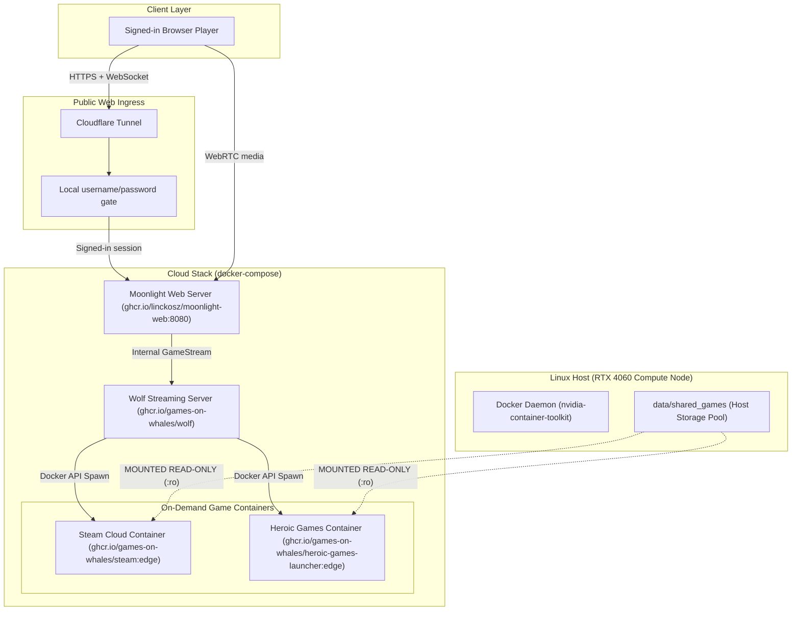

# RYOKU // CLOUD GAMING PLATFORM

```text
+-----------------------------------------------------------------------------------+
|  RYOKU CLOUD GAMING  //  HEADLESS CLOUD GAMING INFRASTRUCTURE                     |
|  ARCHITECTURE : DOCKER ON-DEMAND + GAMES ON WHALES (WOLF)                         |
|  APPS         : STEAM CLOUD + HEROIC GAMES LAUNCHER (EPIC & GOG)                  |
|  STORAGE      : SHARED READ-ONLY GAMES (:ro) + PER-CLIENT WRITABLE APP HOMES     |
|  ACCESS       : LOCAL USERNAME/PASSWORD ACCOUNTS (NO GUEST STREAMING)             |
|  STREAMING    : MOONLIGHT WEB (BROWSER WEBCODECS + WASM) + NATIVE MOONLIGHT       |
|  TARGET GPU   : NVIDIA GEFORCE RTX 4060 (NVENC HEVC/H.264 + OPUS AUDIO)           |
+-----------------------------------------------------------------------------------+
```

---

## 1. Core Architecture Highlights

* **Shared Games (Zero Duplication & Anti-Tamper)**:
  Large game installs (Steam, Epic Games, GOG) sit in a single shared directory (`data/shared_games`) and are mounted **Read-Only (`:ro`)** into game containers.
  * *Zero Storage Duplication*: 50GB games are stored once, saving hundreds of gigabytes across users.
  * *Anti-Tamper*: Users cannot delete, rename, overwrite, or corrupt the core game files.
* **Isolated Game Data**:
  Each local player account maps to a private folder in the `ryoku-user-storage` Docker volume for Steam login state, Heroic configuration, game installs, savegames, and Wine/Proton prefixes. Wolf mounts only the active account's app home into its game container. Only one website player can hold the shared Moonlight Web slot at a time. Shared game files remain read-only.
* **Player Accounts**:
  Players create a local username and password. Passwords are salted and hashed on the host; no external identity service, email address, or payment method is used. Guest access to game APIs and streams is denied. See [`deploy/LOCAL_ACCOUNTS.md`](deploy/LOCAL_ACCOUNTS.md).
* **Dual Client Access**:
  * **Moonlight Web (`:8080`)**: Zero-install in-browser streaming via WebCodecs and WebAssembly.
  * Native Moonlight direct pairing is blocked from network interfaces; browser streaming requires a local player account.

---

## 2. Infrastructure Diagram



---

## 3. Quickstart & Deployment

### One-command setup (Arch Linux and pacman-based derivatives)

From the project directory, run:

```bash
./deploy/one_click_arch_setup.sh
```

The installer checks the distribution, installs missing Docker/Compose/NVIDIA
Container Toolkit packages, configures Docker's NVIDIA runtime, loads Wolf's
virtual input devices, prepares persistent storage, pulls the pinned game
images, and enables a system-level boot service. It does not install an NVIDIA
kernel driver because the correct package depends on the distro and kernel.
If Docker needs a runtime change while containers are running, it stops safely
and asks you to rerun during maintenance rather than restarting Docker.

This sets up the gaming host and local portal. Public access still requires a
domain route through Cloudflare Tunnel or router port forwarding; DNS, tunnel
credentials, and router settings cannot be created on the PC by this script.
No automatic reboot is performed. After a kernel or NVIDIA driver update,
reboot if the driver requires it and rerun the installer.

The steps below are the manual alternative for hosts that do not use the
installer. Do not enable the legacy user service in Step 4 after installing the
system service above.

### Step 1: Enable Docker on Host
```bash
sudo systemctl enable --now docker && sudo usermod -aG docker $USER
```

### Step 2: Initialize Cloud Node
Run the provisioning script to check the host GPU setup, create the persistent app-state volume, and pull the required containers:
```bash
./deploy/setup_cloud_node.sh
```

### Step 3: Local Accounts
No identity provider or payment configuration is required. New players can register directly on the portal. Local accounts and password hashes are persisted in the `ryoku-access-state` volume.

### Step 4: Enable Automatic Startup
```bash
./deploy/enable_autostart.sh
```
This installs and enables a user systemd service. It starts the gaming stack at boot without a desktop login and waits for Docker to become ready.

### Step 5: Play Games
* **In Web Browser**: Open `https://play.vanshdev.online` and create a local player account or sign in.
* Select **Steam Cloud Gaming** or **Heroic Games Launcher (Epic & GOG)**. The first launch may take a few minutes while the launcher container starts.

No games are preloaded. Players install games they own into their private profile. The optional `data/shared_games` directory is empty by default and is mounted read-only; only place shared game files there when the launcher supports using them from a read-only library.

For low-latency internet media, forward UDP ports `48550-48573` to the gaming host if the router does not support UPnP. Cloudflare Tunnel carries the site and WebSocket signalling; it does not carry WebRTC media. See [`deploy/LOCAL_ACCOUNTS.md`](deploy/LOCAL_ACCOUNTS.md) for account storage and registration details.
