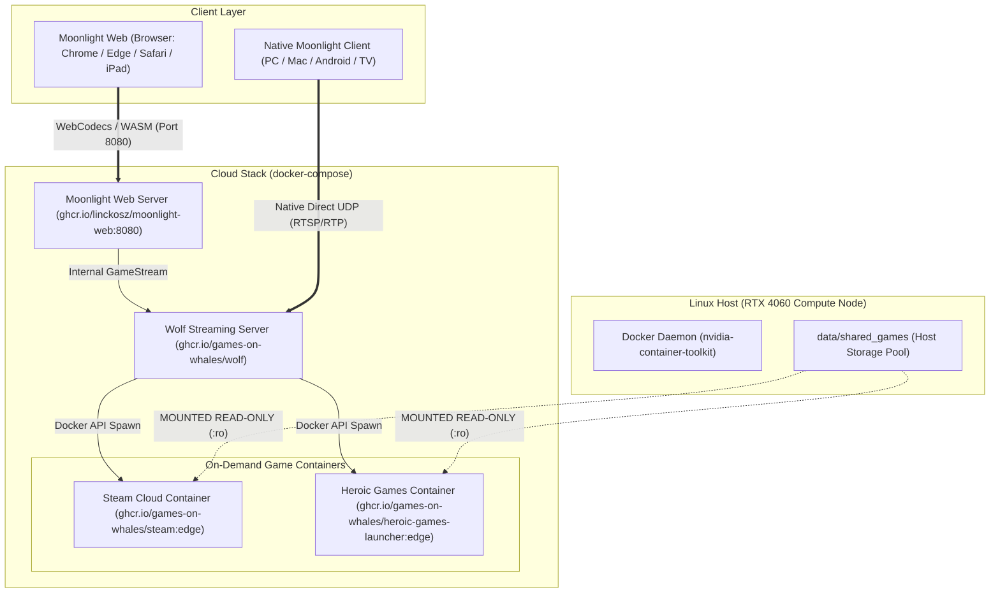

# RYOKU // CLOUD GAMING PLATFORM

```text
+-----------------------------------------------------------------------------------+
|  RYOKU CLOUD GAMING  //  HEADLESS CLOUD GAMING INFRASTRUCTURE                     |
|  ARCHITECTURE : DOCKER ON-DEMAND + GAMES ON WHALES (WOLF)                         |
|  APPS         : STEAM CLOUD + HEROIC GAMES LAUNCHER (EPIC & GOG)                  |
|  STORAGE      : SHARED READ-ONLY GAMES (:ro) + ISOLATED PER-USER SAVES (:rw)      |
|  STREAMING    : MOONLIGHT WEB (BROWSER WEBCODECS + WASM) + NATIVE MOONLIGHT       |
|  TARGET GPU   : NVIDIA GEFORCE RTX 4060 (NVENC HEVC/H.264 + OPUS AUDIO)           |
+-----------------------------------------------------------------------------------+
```

---

## 1. Core Architecture Highlights

* **Shared Games (Zero Duplication & Anti-Tamper)**:
  Large game installs (Steam, Epic Games, GOG) sit in a single shared directory (`data/shared_games`) and are mounted **Read-Only (`:ro`)** into game containers.
  * *Zero Storage Duplication*: 50GB games are stored once, saving hundreds of gigabytes across users.
  * *Anti-Tamper*: Users cannot delete, rename, overwrite, or corrupt the core game files.
* **Isolated User Storage**:
  Each player's Steam login, Heroic configuration, savegames, and Wine/Proton prefixes are isolated in a private read-write volume (`ryoku-user-storage`). User A cannot access or overwrite User B's progress.
* **Dual Client Access**:
  * **Moonlight Web (`:8080`)**: Zero-install in-browser streaming via WebCodecs and WebAssembly.
  * **Native Moonlight Client**: Direct UDP streaming up to 120 FPS / 4K.

---

## 2. Infrastructure Diagram



---

## 3. Quickstart & Deployment

### Step 1: Enable Docker on Host
```bash
sudo systemctl enable --now docker && sudo usermod -aG docker $USER
```

### Step 2: Initialize Cloud Node
Run the provisioning script to generate the driver volume for driver `615.78.08` and pull all required containers:
```bash
./deploy/setup_cloud_node.sh
```

### Step 3: Start the Stack
```bash
docker compose up -d
```

### Step 4: Stream Games
* **In Web Browser**: Open `http://localhost:8080` (or `http://100.89.198.41:8080` over Tailscale).
* **In Native Moonlight**: Connect to Host IP `100.89.198.41`.
* Select **Steam Cloud Gaming** or **Heroic Games Launcher (Epic & GOG)** to start playing immediately.
